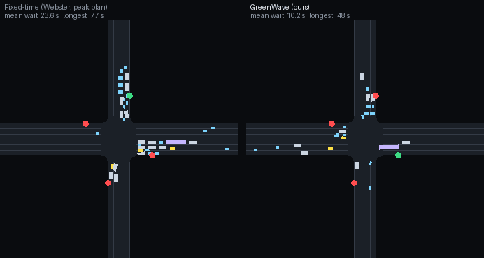

# GreenWave-RL

**Fairness-aware deep reinforcement learning for adaptive signal control under mixed Indian traffic.**
Agents learn to choose signal phases from live queues, weighting people rather than vehicles and never starving a minor road.

[](https://github.com/fortunatechick/greenwave-rl/actions/workflows/ci.yml)


[](https://SITE_URL)



## What it does

- Simulates a signalised four-arm junction in SUMO with left-hand traffic, four vehicle classes
  (two-wheelers, auto-rickshaws, cars, buses), sub-lane movement and approach-wise split phasing.
- Trains a Double DQN written from scratch, plus Stable-Baselines3 DQN and PPO, and compares them with
  Webster fixed-time, actuated, max-pressure and random control across four demand regimes.
- Contributes a passenger-weighted reward with a fairness penalty, and measures how policies trained on one
  demand pattern hold up on another, with and without domain randomisation.

## Key results

<!-- results:start -->
Wait per person in seconds (mean over evaluation seeds), and the longest wait in the skewed regime.

| Controller | Low | Peak | Skewed | Surge | Max wait, skewed (s) |
| --- | --- | --- | --- | --- | --- |
| Fixed-time (stale peak plan) | 29.9 | 34.2 | 68.0 | 50.7 | 268 |
| Fixed-time (matched plan) | 12.1 | 34.2 | 25.7 | 36.4 | 179 |
| Actuated | 12.4 | 23.0 | 18.0 | 20.8 | 151 |
| Max-pressure | 9.1 | 16.3 | 17.8 | 17.6 | 208 |
| DQN, SB3 (trained on peak) | 15.0 | 22.0 | 20.6 | 17.6 | 218 |
| PPO, SB3 (trained on peak) | 12.1 | 21.7 | 14.5 | 17.3 | 125 |
| Double DQN, fair reward (ours) | 9.3 | 21.3 | 17.7 | 14.9 | 175 |
| Double DQN, fair + DR (ours) | 14.5 | 28.5 | 14.7 | 18.1 | 147 |

Against a fixed-time plan tuned for each demand pattern, the regime-matched Double DQN cuts wait per person significantly in 3 of 4 regimes (low, peak, surge). Against max-pressure, a rule that needs no training, it is significantly better on wait per person in no regime, significantly worse in no regime, and statistically tied in low, peak, skewed, surge. On the maximum wait it is better in no regime, worse in no regime and tied in low, peak, skewed, surge. Significance is a Welch t-test over 10 held-out seeds at p < 0.05.

> **Data: synthetic demand.** Demand is **synthetic**: no vehicles were counted at a real junction.
<!-- results:end -->

Full tables, ablations and the generalisation study: [`report/REPORT.md`](report/REPORT.md) and the live site.

## Method in brief

The signal is controlled as a Markov decision process. Every 5 s the agent either extends the current green or
names the approach to serve next. Minimum green (10 s), yellow (3 s) and maximum green (60 s) are enforced by the
environment and are never learned. The reward is

$$r_t = \frac{1}{\kappa}\sum_c w_c\,(W_{c,t-1} - W_{c,t}) - \lambda\,\frac{\max(0,\ \max_a \text{wait}_a - T)}{T}$$

where $W_{c,t}$ is the accumulated waiting time of class-$c$ vehicles on the approaches, $w_c$ the passenger weight
of the class and $\text{wait}_a$ the longest wait on approach $a$.

## Quick start

```bash
python -m venv .venv
.venv/bin/pip install -r requirements.txt     # Windows: .venv\Scripts\pip
python tasks.py all                           # or: make all
python tasks.py demo                          # two SUMO GUI windows side by side
```

`python tasks.py all` rebuilds the network and demand, re-evaluates every controller from the saved checkpoints in
`results/models/`, and regenerates every figure, replay, report table and the website data. It does not retrain.

SUMO comes from the `eclipse-sumo` wheel, so there is nothing to install separately.

## Reproduce the training

```bash
python tasks.py train        # budget planner, then the job queue (resumable)
```

| Profile | Main runs | Ablation runs | Seeds (main / ablation) | Use |
| --- | --- | --- | --- | --- |
| quick | 20k steps | 10k | 1 / 1 | CI and smoke tests |
| day | 100k steps | 50k | 3 / 2 | one-day build |
| full | 250k steps | 150k | 5 / 3 | final report |

`experiments/budget.py` measures simulation speed and picks the largest profile that fits `--hours`. Training is
CPU-bound; a GPU adds almost nothing.

<!-- hardware:start -->
This repository's results: profile `day`, 58 training jobs, 26.7 CPU-hours on 7 workers (Intel i5-12450H, 16 GB RAM, Windows 11), measured at 55 decisions per second per simulation.
<!-- hardware:end -->

## Repository layout

```
configs/        junction, simulation, demand, reward, training and experiment configs
network/        plain-XML network builder, toy junction, Webster signal programs
demand/         vehicle types, counts, route generator for the four regimes
greenwave/      importable package: env, rewards, controllers, agents, metrics
experiments/    budget planner, job queue, evaluation, figures, replay recorder, web export
demo/           live side-by-side SUMO demo and Streamlit dashboard
tests/          safety, reward, Webster, max-pressure, metric and schema tests
results/        summaries (committed) and best checkpoints
report/         REPORT.md, slides.md, viva.md and figures, generated from the summaries
web/            Next.js static site that replays recorded simulations
```

## Website

```bash
cd web
npm ci
npm run dev          # http://localhost:3000
npm run build        # static export to web/out (fails if mock data would ship)
```

The site is a static export: SUMO cannot run on Vercel, so it plays back recorded simulations and renders exported
results from `web/public/data/`. To deploy, import the repository on Vercel with **Root Directory `web`** and the
Next.js preset; no environment variables are required (`NEXT_PUBLIC_SITE_URL` is optional).

## Limitations

- Nothing here has run on a street. Sim-to-real gap: sensing errors, driver behaviour, pedestrians, certification.
- The agent reads exact queues and waiting times from the simulator.
- One isolated junction; decisions of 5 to 18 s share one discount factor.
- Demand and occupancy weights are stated assumptions (see `DECISIONS.md` for every deviation from the build spec).

## Future work

A corridor of three to five junctions with coordinated multi-agent control, bus and emergency-vehicle priority,
camera-based state estimation, pedestrian phases.

## Citation

```bibtex
@misc{greenwave_rl_2026,
  title  = {GreenWave-RL: Fairness-Aware Deep Reinforcement Learning for Adaptive Signal Control under Mixed Indian Traffic},
  author = {{GreenWave-RL authors}},
  year   = {2026},
  note   = {Course project, Artificial Intelligence, B.Tech Computer Engineering}
}
```

## License

MIT. See [LICENSE](LICENSE).
