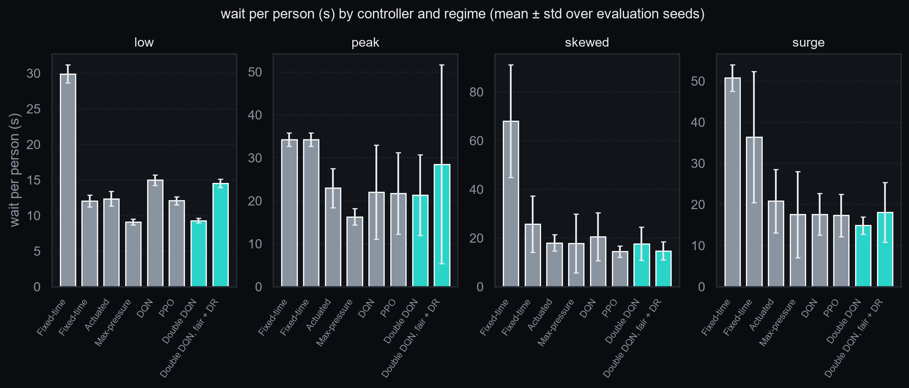
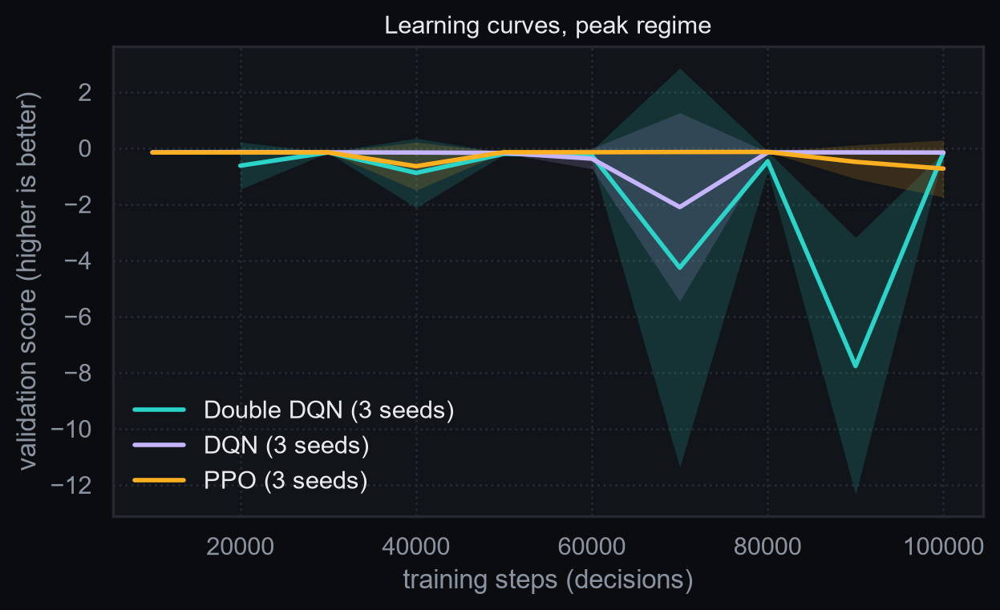
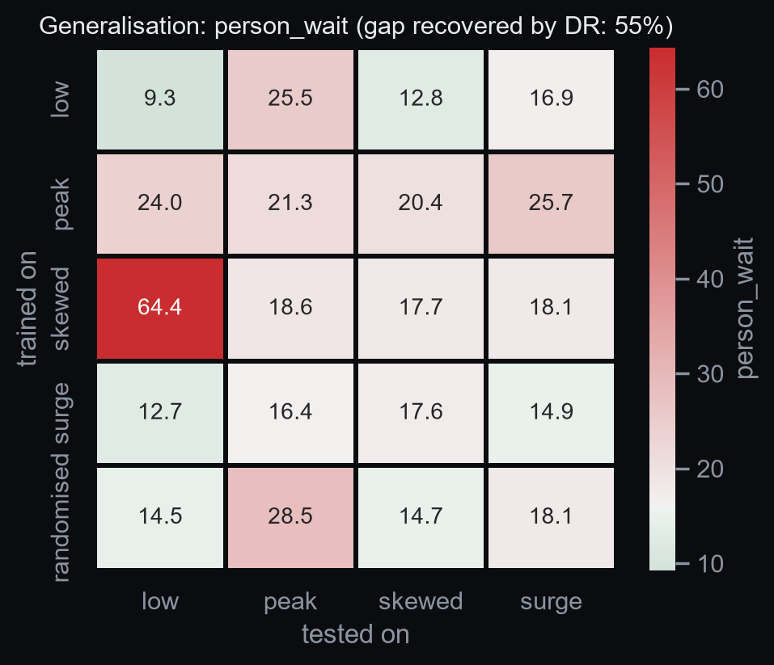
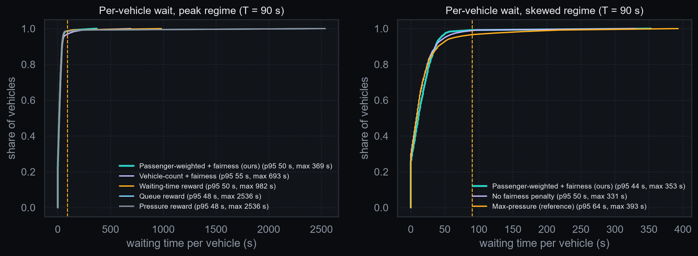

# GreenWave-RL: Fairness-Aware Deep Reinforcement Learning for Adaptive Signal Control under Mixed Indian Traffic

_Generated by `report/fill.py` from `results/summary/` (build ff8a5af, 2026-10-09,
compute profile `day`). Do not edit numbers by hand; re-run the script._

## Abstract

Fixed-time traffic signals cannot respond to demand that changes by the minute. This project builds a microscopic
simulation of a signalised four-arm junction populated with mixed traffic (two-wheelers, auto-rickshaws, cars, buses)
and trains deep reinforcement learning agents to choose signal phases from live queue observations. Double DQN
(written from scratch), DQN and PPO are compared against fixed-time, actuated and max-pressure controllers across four
demand regimes. The contribution is a passenger-weighted reward with a fairness penalty that keeps the agent from
starving low-volume approaches, and a measurement of how well policies trained on one demand pattern survive on
another, with and without domain randomisation.

Headline numbers:

- Wait per person vs fixed-time, surge regime: **-59%** (14.9 s against 36.4 s with a Webster plan tuned for the surge)
- Longest wait vs an agent without the fairness penalty: **-34%** (115 s against 174 s, skewed regime, budget-matched runs; p = 0.029, significant)
- Bus delay vs a vehicle-count reward: **-22%** (29.3 s against 37.8 s, peak regime, budget-matched runs; p = 0.17, not statistically significant)

Against a fixed-time plan tuned for each demand pattern, the regime-matched Double DQN cuts wait per person significantly in 3 of 4 regimes (low, peak, surge). Against max-pressure, a rule that needs no training, it is significantly better on wait per person in no regime, significantly worse in no regime, and statistically tied in low, peak, skewed, surge. On the maximum wait it is better in no regime, worse in no regime and tied in low, peak, skewed, surge. Significance is a Welch t-test over 10 held-out seeds at p < 0.05.

## 1. Introduction

Signal timing plans are tuned by hand for an average hour and go stale. Indian traffic is mixed and weakly
lane-disciplined, which most published RL signal work ignores. Counting vehicles equally undervalues a bus carrying
40 people against a car carrying 2. And an agent
that minimises average delay can learn to hold a minor road on red indefinitely, which a deployable controller must
not do.

**Problem statement.** Given a signalised junction with time-varying, heterogeneous traffic, learn a phase-selection
policy that minimises delay per person, keeps the worst-case wait bounded, and stays effective when demand shifts
away from what it was trained on.

**Contributions.** (1) A passenger-weighted waiting-time reward with a maximum-wait fairness penalty. (2) A
left-hand-traffic setting with four vehicle classes, sub-lane movement, free left turns and approach-wise split
phasing. (3) A generalisation study that reports failures and measures what domain randomisation recovers.

## 2. Related work

Reinforcement learning for signal control is well studied. DQN (Mnih et al., 2015) and Double DQN (van Hasselt et
al., 2016) are the value-based methods used here; PPO (Schulman et al., 2017) is the policy-gradient comparison.
IntelliLight and PressLight (Wei et al., 2018, 2019) apply deep RL to signals; PressLight builds on max-pressure
control (Varaiya, 2013), which is throughput-optimal under idealised assumptions and is kept as a baseline in every
table of this report. Ault and Sharon (2021) argue for benchmarking RL signal controllers against strong classical
baselines, which is the stance taken here. SUMO (Lopez et al., 2018) is the simulator. PCU factors follow IRC:106-1990
style values. These references are listed from memory and must be checked before citing.

## 3. Method

### 3.1 Decision process

| Element | Definition |
| --- | --- |
| State | Per incoming lane: PCU-weighted halting queue and PCU density over lane capacity. Plus current green approach (one-hot), time since last change over maximum green, and longest accumulated wait per approach over T. |
| Action | The approach to serve next; choosing the current one extends its green by 5 s. |
| Safety | Minimum green 10 s, yellow 3 s on every change, maximum green 60 s. Enforced by the environment, never learned. |
| Reward | Passenger-weighted reduction in accumulated waiting time minus a fairness penalty (below). |
| Episode | 3600 simulated seconds, gamma = 0.99 per decision. The end is a truncation, so the last state is bootstrapped. |

Transitions last 5 s (extend), 13 s (yellow plus minimum green) or 18 s (a forced switch at maximum green). A
constant discount per decision is used: a semi-MDP simplification.

### 3.2 Reward

$$r_t = \frac{1}{\kappa}\sum_c w_c\,(W_{c,t-1} - W_{c,t}) - \lambda\,\frac{\max(0,\ \max_a \text{wait}_a - T)}{T}$$

with kappa = 100, lambda = 4 and T = 90 s. Passenger weights (assumptions):
two-wheeler 1.5, auto-rickshaw 2.5, car 2, bus 40. In the reward the weights are
divided by the mean occupancy of the traffic mix (4.525), which preserves their ratios
and gives the passenger-weighted reward the scale of the vehicle-count reward.

lambda and T were chosen by a sweep of nine short runs on the skewed regime, scored on seeds that are used neither for
training nor for evaluation:

| lambda | T (s) | Wait / person (s) | Max wait (s) | max wait <= 1.2 T |
| --- | --- | --- | --- | --- |
| 0.25 | 120 | 13.8 | 184 | no |
| 0.25 | 60 | 13.6 | 86 | no |
| 0.25 | 90 | 36.7 | 421 | no |
| 1 | 120 | 15.7 | 129 | yes |
| 1 | 60 | 14.4 | 125 | no |
| 1 | 90 | 26.2 | 261 | no |
| 4 | 120 | 14.7 | 77 | yes |
| 4 | 60 | 18.8 | 169 | no |
| 4 | 90 | 13.3 | 74 | yes |

Rule: lowest person delay among settings with max wait <= 1.2 T. Chosen: lambda = 4, T = 90 s.

### 3.3 Agents

- **Double DQN (main agent), from scratch in PyTorch.** MLP 128-128, replay buffer 50k, batch 64, Adam, epsilon 1.0
  to 0.05 over the first half of training, Huber loss, gradient-norm clip 10. Target
  `y = r + gamma (1 - d) Q_target(s', argmax_a Q_online(s', a))` with `d = 1` only on true termination.
- **DQN (Stable-Baselines3).** Vanilla DQN, not Double DQN, with matching network and schedule.
- **PPO (Stable-Baselines3).** Four parallel simulations, 512 steps per rollout.

On the toy junction the scratch Double DQN reached a mean wait of 52 s per vehicle against 131 s for a random policy within 20k steps.

### 3.4 Baselines

Fixed-time with Webster's cycle length `C0 = (1.5 L + 5) / (1 - Y)` in two variants (a plan computed for each regime,
and the peak plan applied everywhere), SUMO's actuated controller (10 to 60 s, 3 s gap), max-pressure, and a random
phase policy. All run through the same environment and metric code.

## 4. Experimental setup

Junction: Generic 4-arm junction (plain XML); geometry from plain XML simplified to lane counts.
SUMO 1.28.0 with the sub-lane model. Demand is **synthetic**: no vehicles were counted at a real junction.

| Regime | veh/h | Webster cycle (s) | Greens N,E,S,W (s) | Max degree of saturation |
| --- | --- | --- | --- | --- |
| low | 1454 | 52 | [10, 10, 10, 10] | 0.46 |
| peak | 3636 | 120 | [27, 27, 27, 27] | 0.85 |
| skewed | 3272 | 88 | [14, 34, 14, 14] | 0.78 |
| surge | 2872 | 78 | [15, 21, 15, 15] | 0.74 |

Class mix by count: two-wheeler 45%, auto-rickshaw 18%, car 30%, bus 7%. Turn split:
left 25 %, through 55 %, right 20 %. Arrivals are Poisson.

Evaluation: policies are frozen (epsilon = 0), 10 evaluation seeds per regime, never used in
training. RL rows average 3 independently trained policies per evaluation seed. Tables show
mean ± standard deviation over evaluation seeds.

## 5. Results

### 5.1 Main comparison

`*` marks p < 0.05 against fixed-time (matched plan) and `†` against max-pressure (Welch's t-test). Bold is the best
value in a column.

**Low regime**

| Controller | Wait / person (s) | Wait / vehicle (s) | Avg queue (veh) | Throughput (veh/h) | Max wait (s) | Wait p95 (s) | CO2 (g/veh) |
| --- | --- | --- | --- | --- | --- | --- | --- |
| Fixed-time (stale peak plan) | 29.9 ± 1.3*† | 29.3 ± 0.8*† | 11.6 ± 0.4*† | 1393 ± 37 | 91 ± 1* | 82 ± 1*† | 160 ± 3*† |
| Fixed-time (matched plan) | 12.1 ± 0.8† | 12.1 ± 0.4† | 4.8 ± 0.2† | 1400 ± 39 | **50 ± 9**† | **36 ± 0**† | 132 ± 3 |
| Actuated | 12.4 ± 1.0† | 11.8 ± 0.3† | 4.7 ± 0.2† | **1400 ± 39** | 53 ± 9† | 36 ± 1* | 131 ± 3 |
| Max-pressure | **9.1 ± 0.4*** | **10.6 ± 0.5*** | **4.2 ± 0.2*** | 1399 ± 38 | 95 ± 15* | 37 ± 1* | **129 ± 3** |
| Random phase | 28.6 ± 1.9*† | 25.6 ± 1.4*† | 10.1 ± 0.7*† | 1398 ± 39 | 217 ± 38*† | 100 ± 7*† | 155 ± 3*† |
| DQN, SB3 (trained on peak) | 15.0 ± 0.7*† | 17.8 ± 0.3*† | 7.0 ± 0.2*† | 1397 ± 40 | 114 ± 7*† | 63 ± 1*† | 140 ± 3*† |
| PPO, SB3 (trained on peak) | 12.1 ± 0.6† | 13.0 ± 0.3*† | 5.1 ± 0.2*† | 1399 ± 39 | 66 ± 3*† | 40 ± 1*† | 133 ± 3† |
| Double DQN, fair reward (ours) | 9.3 ± 0.3* | 11.7 ± 0.3*† | 4.6 ± 0.1† | 1400 ± 39 | 94 ± 4* | 45 ± 2*† | 131 ± 3 |
| Double DQN, fair + DR (ours) | 14.5 ± 0.6*† | 17.3 ± 0.3*† | 6.8 ± 0.1*† | 1397 ± 39 | 118 ± 8*† | 62 ± 2*† | 139 ± 3*† |

**Peak regime**

| Controller | Wait / person (s) | Wait / vehicle (s) | Avg queue (veh) | Throughput (veh/h) | Max wait (s) | Wait p95 (s) | CO2 (g/veh) |
| --- | --- | --- | --- | --- | --- | --- | --- |
| Fixed-time (stale peak plan) | 34.2 ± 1.6† | 33.5 ± 0.7† | 33.6 ± 1.0† | 3526 ± 66 | 110 ± 14 | 83 ± 1† | 174 ± 3† |
| Fixed-time (matched plan) | 34.2 ± 1.6† | 33.5 ± 0.7† | 33.6 ± 1.0† | 3526 ± 66 | 110 ± 14 | 83 ± 1† | 174 ± 3† |
| Actuated | 23.0 ± 4.5*† | 22.7 ± 4.5*† | 22.7 ± 4.5*† | 3516 ± 97 | 137 ± 101 | 67 ± 22*† | 155 ± 7*† |
| Max-pressure | **16.3 ± 1.9*** | **16.2 ± 1.6*** | **16.2 ± 1.8*** | 3537 ± 72 | **98 ± 29** | **47 ± 4*** | **146 ± 5*** |
| Random phase | 60.9 ± 30.0*† | 58.4 ± 30.0*† | 58.4 ± 29.9*† | 3487 ± 74 | 394 ± 155*† | 200 ± 119*† | 227 ± 61*† |
| DQN, SB3 (trained on peak) | 22.0 ± 11.0* | 22.5 ± 12.0* | 22.3 ± 11.2* | 3540 ± 81 | 151 ± 102 | 78 ± 61 | 158 ± 22* |
| PPO, SB3 (trained on peak) | 21.7 ± 9.5* | 21.1 ± 9.5* | 20.9 ± 9.0* | 3541 ± 80 | 119 ± 68 | 69 ± 49 | 156 ± 17* |
| Double DQN, fair reward (ours) | 21.3 ± 9.4* | 21.7 ± 9.9* | 21.4 ± 9.1* | **3541 ± 74** | 142 ± 84 | 72 ± 48 | 156 ± 19* |
| Double DQN, fair + DR (ours) | 28.5 ± 23.2 | 29.0 ± 25.1 | 28.8 ± 24.7 | 3529 ± 78 | 223 ± 203 | 117 ± 137 | 171 ± 50 |

**Skewed regime**

| Controller | Wait / person (s) | Wait / vehicle (s) | Avg queue (veh) | Throughput (veh/h) | Max wait (s) | Wait p95 (s) | CO2 (g/veh) |
| --- | --- | --- | --- | --- | --- | --- | --- |
| Fixed-time (stale peak plan) | 68.0 ± 23.1*† | 65.6 ± 22.3*† | 58.4 ± 18.9*† | 3096 ± 79*† | 268 ± 142 | 182 ± 106† | 239 ± 44*† |
| Fixed-time (matched plan) | 25.7 ± 11.6 | 25.5 ± 11.9 | 22.5 ± 9.6 | 3182 ± 64 | 179 ± 176 | 95 ± 78 | 162 ± 25 |
| Actuated | 18.0 ± 3.4 | 17.9 ± 3.2 | 16.0 ± 2.8 | 3186 ± 69 | 151 ± 111 | 55 ± 11 | 147 ± 6 |
| Max-pressure | 17.8 ± 12.1 | 18.4 ± 11.3 | 16.3 ± 10.0 | 3190 ± 69 | 208 ± 125 | 73 ± 57 | 151 ± 23 |
| Random phase | 106.3 ± 13.3*† | 103.1 ± 15.3*† | 86.9 ± 11.4*† | 2878 ± 69*† | 501 ± 106*† | 314 ± 29*† | 332 ± 32*† |
| DQN, SB3 (trained on peak) | 20.6 ± 9.8 | 21.3 ± 9.3 | 18.8 ± 7.8 | 3184 ± 67 | 218 ± 124 | 97 ± 59 | 154 ± 19 |
| PPO, SB3 (trained on peak) | **14.5 ± 2.3*** | **14.8 ± 2.1*** | **13.2 ± 1.8*** | **3190 ± 69** | **125 ± 43** | **54 ± 12** | **143 ± 6*** |
| Double DQN, fair reward (ours) | 17.7 ± 6.8 | 18.4 ± 6.5 | 16.3 ± 5.6 | 3178 ± 82 | 175 ± 69 | 76 ± 37 | 152 ± 14 |
| Double DQN, fair + DR (ours) | 14.7 ± 3.7* | 15.7 ± 3.3* | 13.9 ± 2.7* | 3189 ± 69 | 147 ± 55 | 63 ± 22 | 144 ± 6 |

**Surge regime**

| Controller | Wait / person (s) | Wait / vehicle (s) | Avg queue (veh) | Throughput (veh/h) | Max wait (s) | Wait p95 (s) | CO2 (g/veh) |
| --- | --- | --- | --- | --- | --- | --- | --- |
| Fixed-time (stale peak plan) | 50.7 ± 3.2*† | 50.9 ± 2.4*† | 40.2 ± 2.5*† | 2786 ± 73 | 252 ± 6† | 168 ± 10† | 211 ± 6*† |
| Fixed-time (matched plan) | 36.4 ± 16.0† | 35.2 ± 14.1† | 27.7 ± 11.3† | 2795 ± 73 | 231 ± 152 | 126 ± 80 | 187 ± 30† |
| Actuated | 20.8 ± 7.7* | 19.9 ± 7.2* | 15.7 ± 5.7* | 2796 ± 73 | 169 ± 117 | 68 ± 42 | 152 ± 16* |
| Max-pressure | 17.6 ± 10.5* | 18.3 ± 11.3* | 14.2 ± 8.7* | **2800 ± 73** | 162 ± 118 | 71 ± 65 | 152 ± 23* |
| Random phase | 66.2 ± 8.2*† | 65.8 ± 5.8*† | 52.0 ± 5.5*† | 2788 ± 72 | 426 ± 30*† | 267 ± 17*† | 247 ± 16*† |
| DQN, SB3 (trained on peak) | 17.6 ± 5.1* | 18.6 ± 5.0* | 14.6 ± 3.7* | 2797 ± 74 | 157 ± 62 | 71 ± 30 | 150 ± 11* |
| PPO, SB3 (trained on peak) | 17.3 ± 5.1* | 17.1 ± 4.6* | 13.4 ± 3.5* | 2798 ± 73 | 134 ± 65 | 62 ± 28* | 149 ± 11* |
| Double DQN, fair reward (ours) | **14.9 ± 2.1*** | **15.7 ± 2.0*** | **12.3 ± 1.7*** | 2796 ± 74 | **122 ± 38** | **51 ± 9*** | **146 ± 5*** |
| Double DQN, fair + DR (ours) | 18.1 ± 7.2* | 18.8 ± 6.5* | 14.6 ± 4.6* | 2798 ± 74 | 151 ± 75 | 73 ± 43 | 151 ± 11* |

In the surge regime the regime-matched Double DQN reaches 14.9 s of waiting per person, against 36.4 s for
the matched fixed-time plan and 17.6 s for max-pressure. The stale peak plan against the matched plan, wait per
person: low: 29.9 s vs 12.1 s; skewed: 68.0 s vs 25.7 s; surge: 50.7 s vs 36.4 s.

### 5.2 Learning curves

### 5.3 Generalisation and domain randomisation

**person_wait** (diagonal mean 15.8, off-diagonal mean 22.8, gap recovered by DR: 55%)

| Trained on \ tested on | low | peak | skewed | surge |
| --- | --- | --- | --- | --- |
| low | 9.3 | 25.5 | 12.8 | 16.9 |
| peak | 24.0 | 21.3 | 20.4 | 25.7 |
| skewed | 64.4 | 18.6 | 17.7 | 18.1 |
| surge | 12.7 | 16.4 | 17.6 | 14.9 |
| **randomised (DR)** | **14.5** | **28.5** | **14.7** | **18.1** |

**max_wait** (diagonal mean 133.2, off-diagonal mean 182.2, gap recovered by DR: 46%)

| Trained on \ tested on | low | peak | skewed | surge |
| --- | --- | --- | --- | --- |
| low | 93.8 | 161.3 | 131.1 | 146.5 |
| peak | 143.3 | 142.1 | 187.9 | 195.6 |
| skewed | 495.7 | 150.3 | 174.9 | 194.3 |
| surge | 112.3 | 96.7 | 171.9 | 121.9 |
| **randomised (DR)** | **117.6** | **222.7** | **146.9** | **151.2** |

### 5.4 Fairness

### 5.5 Ablations

Each ablation is trained with the ablation budget and compared with a reference trained with the same budget.

**Which objective produces the best real behaviour?** (peak regime)

| Variant | Wait / person (s) | Max wait (s) | Bus delay (s) |
| --- | --- | --- | --- |
| ours (passenger + fairness) (reference) | 18.6 ± 4.8 | 116.2 ± 60.8 | 29.3 ± 5.6 |
| waiting time | 20.5 ± 10.3 | 142.5 ± 138.0 | 32.4 ± 12.4 |
| queue length | 25.5 ± 30.4 | 212.8 ± 388.8 | 33.8 ± 24.0 |
| pressure | 25.5 ± 30.4 | 212.8 ± 388.8 | 33.8 ± 24.0 |

The reference (ours (passenger + fairness)) has the lowest wait per person, 18.6 s; the weakest variant (queue length) reaches 25.5 s (p = 0.49, not significant). The queue and pressure rewards give identical runs: the exits of an isolated junction never queue, so the two rewards are the same number.

**Does the agent starve the minor road without the fairness penalty?** (skewed regime)

| Variant | Wait / person (s) | Max wait (s) | Bus delay (s) |
| --- | --- | --- | --- |
| with fairness penalty (reference) | 15.7 ± 3.5 | 115.4 ± 64.4 | 26.9 ± 5.0 |
| no penalty (lambda = 0) | 12.9 ± 1.9 | 174.2 ± 42.6 | 22.2 ± 3.3 |

Without the penalty the maximum wait goes from 115 s to 174 s (+51%, p = 0.029, significant) and wait per person from 15.7 s to 12.9 s (p = 0.046, significant).

**Do buses clear faster with passenger weighting, and at what cost to others?** (peak regime)

| Variant | Wait / person (s) | Max wait (s) | Bus delay (s) |
| --- | --- | --- | --- |
| passenger-weighted (reference) | 18.6 ± 4.8 | 116.2 ± 60.8 | 29.3 ± 5.6 |
| vehicle-count | 24.2 ± 12.9 | 137.2 ± 112.1 | 37.8 ± 17.2 |

Passenger weighting gives a bus delay of 29.3 s against 37.8 s with vehicle counting (-22%, p = 0.17, not significant); car delay is 28.9 s against 34.5 s (p = 0.32, not significant).

**How sensitive are results to the bus occupancy assumption?** (peak regime)

| Variant | Wait / person (s) | Max wait (s) | Bus delay (s) |
| --- | --- | --- | --- |
| bus = 20 | 20.9 ± 7.7 | 144.1 ± 70.2 | 32.7 ± 10.6 |
| bus = 40 (reference) | 18.6 ± 4.8 | 116.2 ± 60.8 | 29.3 ± 5.6 |
| bus = 60 | 21.1 ± 10.5 | 165.3 ± 137.7 | 31.9 ± 12.3 |

Bus delay by assumed occupancy (bus = 20: 32.7 s, bus = 40: 29.3 s, bus = 60: 31.9 s). Wait per person varies by 2.5 s across the three weights.

**Which observations matter?** (peak regime)

| Variant | Wait / person (s) | Max wait (s) | Bus delay (s) |
| --- | --- | --- | --- |
| full state (reference) | 18.6 ± 4.8 | 116.2 ± 60.8 | 29.3 ± 5.6 |
| no phase timer | 25.8 ± 11.8 | 176.8 ± 92.3 | 39.1 ± 15.6 |
| no max-wait feature | 17.8 ± 5.7 | 114.7 ± 48.2 | 29.0 ± 7.9 |

The lowest wait per person comes from 'no max-wait feature' (17.8 s), not the reference (full state, 18.6 s; p = 0.76, not significant).

**Decision interval: reactivity against stability** (peak regime)

| Variant | Wait / person (s) | Max wait (s) | Bus delay (s) |
| --- | --- | --- | --- |
| 5 s (reference) | 18.6 ± 4.8 | 116.2 ± 60.8 | 29.3 ± 5.6 |
| 10 s | 18.4 ± 3.9 | 126.4 ± 59.5 | 29.4 ± 4.9 |
| 15 s | 18.4 ± 7.1 | 104.5 ± 46.7 | 29.5 ± 9.0 |

The lowest wait per person comes from '10 s' (18.4 s), not the reference (5 s, 18.6 s; p = 0.94, not significant).

**Does modelling mixed traffic change the ranking of controllers?** (peak regime)

| Variant | Wait / person (s) | Max wait (s) | Bus delay (s) |
| --- | --- | --- | --- |
| agent, sub-lane on (reference) | 18.6 ± 4.8 | 116.2 ± 60.8 | 29.3 ± 5.6 |
| agent, sub-lane off | 78.0 ± 25.4 | 272.8 ± 105.8 | 112.5 ± 36.5 |
| Max-pressure, sub-lane on | 16.3 ± 1.9 | 97.7 ± 29.4 | 27.2 ± 2.7 |
| Max-pressure, sub-lane off | 76.7 ± 23.6 | 241.9 ± 51.0 | 110.8 ± 33.7 |
| Fixed-time (matched plan), sub-lane on | 34.2 ± 1.6 | 110.1 ± 14.0 | 45.6 ± 2.6 |
| Fixed-time (matched plan), sub-lane off | 48.3 ± 4.2 | 167.7 ± 26.8 | 61.3 ± 5.3 |
| Actuated, sub-lane on | 23.0 ± 4.5 | 136.8 ± 100.8 | 33.0 ± 4.9 |
| Actuated, sub-lane off | 51.1 ± 6.3 | 179.9 ± 25.4 | 62.9 ± 7.0 |

With the sub-lane model off the agent's wait per person is 78.0 s against 18.6 s with it on. The ranking changes from Max-pressure < the agent < Actuated < Fixed-time (matched plan) to Fixed-time (matched plan) < Actuated < Max-pressure < the agent. Every controller is slower without sub-lane movement, so this ablation changes the capacity of the junction and not only the ranking.

## 6. Discussion

Against a fixed-time plan tuned for each demand pattern, the regime-matched Double DQN cuts wait per person significantly in 3 of 4 regimes (low, peak, surge). Against max-pressure, a rule that needs no training, it is significantly better on wait per person in no regime, significantly worse in no regime, and statistically tied in low, peak, skewed, surge. On the maximum wait it is better in no regime, worse in no regime and tied in low, peak, skewed, surge. Significance is a Welch t-test over 10 held-out seeds at p < 0.05.

Max-pressure needs no training and is throughput-optimal under idealised assumptions, so on a single isolated
junction there is limited room for a learned policy to improve on it. Where the learned policy differs is in what it
optimises: people rather than vehicles, and a bound on the worst wait. The tables above show what that costs and
buys in each regime.

## 7. Limitations

- Nothing has run on a street: sensing errors, driver behaviour, pedestrians and safety certification are out of scope.
- The agent reads exact queues and waits from the simulator.
- Constant discount per decision although decisions last 5 to 18 s.
- One isolated junction, so no downstream spill-back or coordination.
- Demand is **synthetic**: no vehicles were counted at a real junction. Occupancy weights are assumptions.

### Deviations from the build specification

- Checkpoint selection metric. checkpoints are selected by the time-averaged potential form of the same objective, `-(1 - gamma) * sum_c w_c W_c / kappa - fairness penalty`, which the discounted return optimises. Queue and pressure rewards do not telescope and are scored directly.
- Passenger weights normalised in the reward. in the reward, passenger weights are divided by the mean occupancy of the traffic mix (4.525 persons per vehicle). Relative weights are unchanged (a bus still counts 20 times a car); the passenger-weighted reward now has the scale of the vehicle-count reward. Equivalent to kappa = 452.5 for the passenger-weighted terms.
- Discount 0.95 and reward clipping. every agent (Double DQN, SB3 DQN, PPO) trains with gamma = 0.95 instead of 0.99 and with rewards clipped to [-3, 3] during training. Both shrink the range of Q-values, which grows with accumulated waiting in congested states. Evaluation metrics are unaffected by clipping.
- Website and delivery choices. The site is a verified static build served locally; the repository is private and Vercel deployment is left to the user. Lighthouse was measured on the home page only (mobile: performance 93, accessibility 100, best practices 100, SEO 100).

## 8. Future work

A corridor of three to five junctions with coordinated multi-agent control; bus and emergency-vehicle priority as
explicit objectives; camera-based state estimation; pedestrian phases.

## References

Sutton and Barto, _Reinforcement Learning: An Introduction_. Mnih et al. (2015). van Hasselt et al. (2016). Schulman
et al. (2017). Varaiya (2013). Wei et al. (2018, 2019). Ault and Sharon (2021). Lopez et al. (2018). IRC:106-1990;
IRC:SP:41. Listed from memory; confirm titles, years and IRC values before citing.
